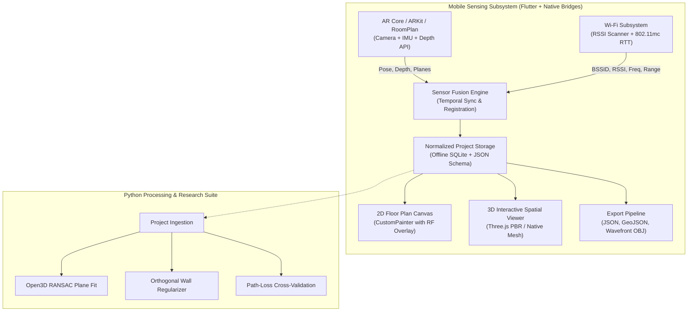

# Wallahi: Computer Vision + Wi-Fi Indoor Spatial Mapping

Wallahi is an offline-first mobile spatial computing platform that unifies camera-based augmented reality computer vision with 802.11 Wi-Fi radio measurements into an interactive, metric-accurate digital twin of indoor environments.

Rather than assuming radio signal strength directly reveals exact wall coordinates or relying on cloud processing, Wallahi establishes clean sensor responsibility boundaries:
- **Computer Vision (ARCore / ARKit / RoomPlan)**: Estimates 6-DoF device trajectories, plane boundaries, floor polygons, structural walls, and architectural openings.
- **Wi-Fi Sensing (RSSI + 802.11mc RTT)**: Captures received signal strength metrics, channel propagation frequencies, and multi-lateration distance estimates to compatible access points.
- **Sensor Fusion Engine**: Registers both data streams into a shared Cartesian metric frame ($XZ$ floor plane, $+Y$ up), associating radio samples to estimated camera poses with calibrated uncertainty propagation.

---

## Architecture Overview



---

## Core Capabilities

1. **Guided Spatial Room Scanning**
   - 6-DoF visual-inertial tracking with drift monitoring.
   - Plane extraction and surface classification (floor, walls, openings).
   - Real-time perimeter closure guidance with confidence feedback.
2. **Multi-Tier Wi-Fi Radio Mapping**
   - **Level 1 (MVP)**: RSSI coverage mapping across 2.4 GHz, 5 GHz, and 6 GHz bands.
   - **Level 2 (RTT Ranging)**: Fine timing measurement (IEEE 802.11mc) for meter-level trilateration constraints.
   - **Level 3 (CSI Research)**: Channel State Information research tools for sub-carrier multi-path analysis.
3. **Rigorous Sensor Fusion & Uncertainty Tracking**
   - Pose association window ($\le 100\text{ ms}$) filtering out tracking-loss and high-velocity motion blur.
   - Spatial grid discretization with robust median aggregation.
   - Distance-penalized spatial uncertainty modeling with rescan prompts.
4. **Interactive 2D/3D Visualization**
   - Hardware-accelerated 2D floor plans with continuous contour heatmaps and uncertainty stippling.
   - Interactive 3D spatial viewer with orbit navigation, extruded geometry, and access point beacons.
   - In-app dimensional correction with orthogonal wall snapping ($90^\circ / 180^\circ$).

---

## Monorepo Layout

```text
wallahi/
├── apps/
│   └── mobile/                # Flutter mobile application
│       ├── android/           # Kotlin ARCore, RSSI, and RTT native bridges
│       ├── ios/               # Swift RoomPlan, ARKit, and Wi-Fi capability bridges
│       └── lib/               # Presentation, state machine, and local storage
├── packages/
│   ├── room_format/           # Canonical normalized JSON project schema
│   ├── geometry/              # Computational geometry, vectors, and wall regularizer
│   ├── wifi_models/           # RF propagation models, IDW, and RTT multilateration
│   └── sensor_fusion/         # Pose-sample registration, grid aggregation, uncertainty
├── processing/
│   ├── open3d/                # Point-cloud filtering and RANSAC segmentation
│   ├── floorplan/             # Orthogonal regularization and loop closure
│   └── evaluation/            # Ground-truth benchmarking and accuracy evaluation
├── backend/                   # Optional FastAPI server for heavy point-cloud processing
└── docs/                      # Architectural, mathematical, and device specifications
```

---

## Getting Started

### Prerequisites
- **Flutter SDK**: `>= 3.24.0`
- **Dart SDK**: `>= 3.5.0`
- **Android SDK**: API level 29+ (Android 10+); API level 28+ required for Wi-Fi RTT.
- **Python**: `>= 3.10` (for processing and evaluation tools).

### Building and Testing

```bash
# Verify Dart packages and run automated tests
cd packages/room_format && dart test
cd ../geometry && dart test
cd ../wifi_models && dart test
cd ../sensor_fusion && dart test

# Run Flutter mobile tests
cd ../../apps/mobile && flutter test

# Run Python processing tests
cd ../../processing && python3 -m unittest discover tests
```

---

## Documentation Index

- [System Architecture](docs/architecture.md)
- [Coordinate System & Mathematical Conventions](docs/coordinate-system.md)
- [Supported Devices & Hardware Capability Matrix](docs/supported-devices.md)
- [Evaluation Protocol & Accuracy Benchmarking](docs/evaluation-protocol.md)
- [RF Propagation & Heatmap Interpolation Models](docs/rf-propagation-model.md)

---

## Contributing

Please review [CONTRIBUTING.md](CONTRIBUTING.md) for details on code style, commit conventions, 500-line physical file limits, and test coverage requirements.

## License

This project is licensed under the MIT License - see the [LICENSE](LICENSE) file for details.
