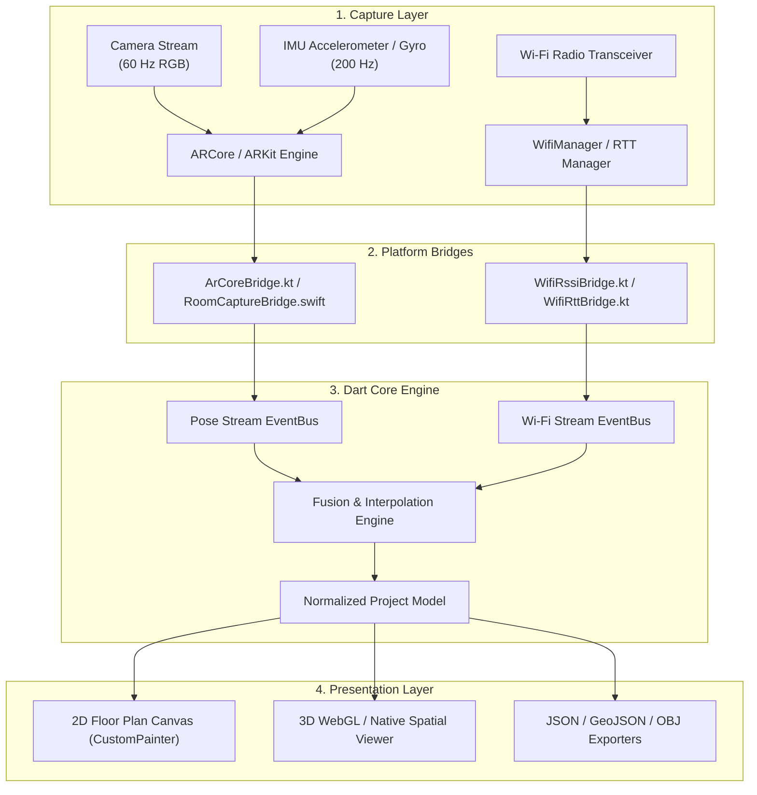

# System Architecture: Wallahi

## 1. System Vision & Layered Separation

Wallahi decouples spatial computing into three orthogonal domains:
1. **Geometric Vision Domain**: High-frequency visual-inertial odometry, plane extraction, and surface reconstruction.
2. **Radio-Frequency (RF) Domain**: Asynchronous Wi-Fi RSSI polling and IEEE 802.11mc Fine Timing Measurement (RTT).
3. **Sensor Fusion Domain**: Spatiotemporal registration, measurement de-noising, spatial interpolation, and uncertainty quantification.

---

## 2. Component Breakdown

### 2.1 Native Platform Bridges
- **Android (`ArCoreBridge.kt`)**: Interfaces with Google ARCore `Session`. Listens to frame updates, extracts camera pose `Pose`, tracks plane states (`Plane.Type.HORIZONTAL_UPWARD_FACING`, `VERTICAL`), and queries depth maps via `DepthApi`.
- **Android (`WifiRssiBridge.kt`)**: Leverages `WifiManager.startScan()` and `WifiManager.getScanResults()`. Implements throttle-aware scan cycles respecting Android background execution limits.
- **Android (`WifiRttBridge.kt`)**: Checks `PackageManager.FEATURE_WIFI_RTT` and `WifiRttManager.isAvailable()`. Constructs `RangingRequest` targets and returns round-trip distance and standard deviation.
- **iOS (`RoomCaptureBridge.swift`)**: Uses Apple `RoomPlan` API where supported (`RoomCaptureSession`) with fallback to ARKit world tracking.
- **iOS (`WifiCapabilityBridge.swift`)**: Provides graceful degradation on iOS due to platform limitations, capturing currently associated SSID/BSSID via `NetworkExtension` where permitted.

### 2.2 Shared Dart Packages
- `packages/room_format`: Data contracts defining projects, walls, openings, access points, Wi-Fi samples, and quality metrics.
- `packages/geometry`: Mathematical vector operations, 2D line segment intersection, polygon area calculation, and orthogonal wall regularizer ($90^\circ / 180^\circ$ snapping).
- `packages/wifi_models`: Log-distance path loss, IDW interpolation, Gaussian RBF kernels, and non-linear least squares multilateration.
- `packages/sensor_fusion`: Temporal interpolation associating Wi-Fi samples to closest AR poses, spatial grid aggregation, and uncertainty estimation.

### 2.3 Mobile App (`apps/mobile`)
- **State Management**: Built on Riverpod with immutable state containers.
- **Scanning State Machine**:
  - `idle`: Ready for new scan or project selection.
  - `calibrating`: AR tracking finding ground plane and anchor.
  - `scanning`: Interactive traversal recording trajectory and Wi-Fi packets.
  - `fusing`: Interpolating heatmap and computing uncertainty contours.
  - `editing`: Interactive correction of wall segments and AP positions.
  - `completed`: Project stored locally and ready for export.
